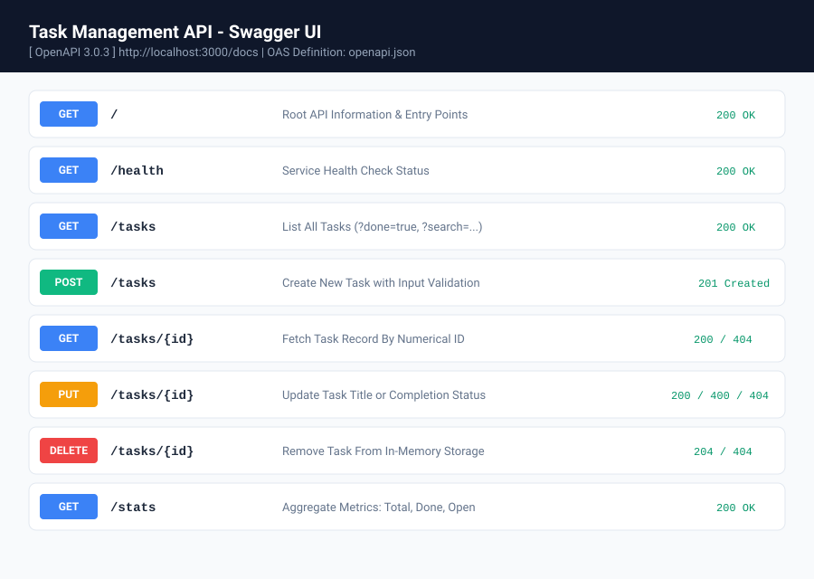

# Task Management API

A lightweight, robust in-memory RESTful CRUD API built with Node.js and Express. It provides comprehensive task lifecycle management, input validation, strict HTTP status code semantics, OpenAPI 3.0 specification, and interactive Swagger UI documentation.



---

## Quickstart

Run the following command to install dependencies and start the server:

```bash
npm install && npm start
```

The server starts locally at `http://localhost:3000`.

Interactive Swagger UI documentation is available at:
```
http://localhost:3000/docs
```

---

## Endpoints

| Method | Endpoint | Description | Request Body | Response Status |
| :--- | :--- | :--- | :--- | :--- |
| `GET` | `/` | API service metadata | None | `200 OK` |
| `GET` | `/health` | Server health check | None | `200 OK` |
| `GET` | `/stats` | Aggregated task statistics | None | `200 OK` |
| `POST` | `/reset` | Restores default seed tasks | None | `200 OK` |
| `GET` | `/tasks` | List all tasks (supports `?done=true/false` & `?search=query`) | None | `200 OK` |
| `GET` | `/tasks/:id` | Retrieve single task by numerical ID | None | `200 OK`, `404 Not Found` |
| `POST` | `/tasks` | Create a new task | `{"title": "Task title"}` | `201 Created`, `400 Bad Request` |
| `PUT` | `/tasks/:id` | Update task title and/or done status | `{"title": "New title", "done": true}` | `200 OK`, `400 Bad Request`, `404 Not Found` |
| `DELETE` | `/tasks/:id` | Delete task by numerical ID | None | `204 No Content`, `404 Not Found` |

---

## Verified cURL Output

### 1. Root Metadata (`GET /`)
```http
HTTP/1.1 200 OK
X-Powered-By: Express
Content-Type: application/json; charset=utf-8
Content-Length: 94
ETag: W/"5e-NhZO7IhTPOJK1ny3rvCgFcozmEM"
Date: Sat, 21 Nov 2026 16:40:03 GMT
Connection: keep-alive
Keep-Alive: timeout=5

{"name":"Task API","version":"1.0","endpoints":["/tasks","/stats","/reset","/health","/docs"]}
```

### 2. Health Check (`GET /health`)
```http
HTTP/1.1 200 OK
X-Powered-By: Express
Content-Type: application/json; charset=utf-8
Content-Length: 15
ETag: W/"f-VaSQ4oDUiZblZNAEkkN+sX+q3Sg"
Date: Sat, 21 Nov 2026 16:40:04 GMT
Connection: keep-alive
Keep-Alive: timeout=5

{"status":"ok"}
```

### 3. List All Tasks (`GET /tasks`)
```http
HTTP/1.1 200 OK
X-Powered-By: Express
Content-Type: application/json; charset=utf-8
Content-Length: 147
ETag: W/"93-48ZbuSVZ3OAoTHembGvEY0b0W68"
Date: Sat, 21 Nov 2026 16:40:04 GMT
Connection: keep-alive
Keep-Alive: timeout=5

[{"id":1,"title":"Learn backend basics","done":true},{"id":2,"title":"Build CRUD API","done":false},{"id":3,"title":"Push to GitHub","done":false}]
```

### 4. Create Task with Validation (`POST /tasks`)
```bash
curl -i -X POST http://localhost:3000/tasks \
  -H "Content-Type: application/json" \
  -d '{"title":"Write documentation"}'
```
```http
HTTP/1.1 201 Created
X-Powered-By: Express
Content-Type: application/json; charset=utf-8
Content-Length: 51
ETag: W/"33-f7fy4ThiSbHmuQpPm/a+lLllEgU"
Date: Sat, 21 Nov 2026 16:40:04 GMT
Connection: keep-alive
Keep-Alive: timeout=5

{"id":4,"title":"Write documentation","done":false}
```

### 5. Update Task (`PUT /tasks/4`)
```bash
curl -i -X PUT http://localhost:3000/tasks/4 \
  -H "Content-Type: application/json" \
  -d '{"done":true}'
```
```http
HTTP/1.1 200 OK
X-Powered-By: Express
Content-Type: application/json; charset=utf-8
Content-Length: 50
ETag: W/"32-VuADOH28rlqbNYpxfQuAl7s1Ia4"
Date: Sat, 21 Nov 2026 16:40:04 GMT
Connection: keep-alive
Keep-Alive: timeout=5

{"id":4,"title":"Write documentation","done":true}
```

### 6. Delete Task (`DELETE /tasks/4`)
```bash
curl -i -X DELETE http://localhost:3000/tasks/4
```
```http
HTTP/1.1 204 No Content
X-Powered-By: Express
Date: Sat, 21 Nov 2026 16:40:04 GMT
Connection: keep-alive
Keep-Alive: timeout=5
```

### 7. Resource Not Found (`GET /tasks/99`)
```http
HTTP/1.1 404 Not Found
X-Powered-By: Express
Content-Type: application/json; charset=utf-8
Content-Length: 29
ETag: W/"1d-kQQdPQ+i/Wk9IgXh55Kh5auGltk"
Date: Sat, 21 Nov 2026 16:40:04 GMT
Connection: keep-alive
Keep-Alive: timeout=5

{"error":"Task 99 not found"}
```

---

## The Mortality Experiment

When tasks are created or modified during the runtime of this API and the Node.js process is stopped and restarted, all newly created and updated records disappear, reverting strictly to the initial three seed items. This occurs because the application stores data exclusively in the process's volatile heap memory (`RAM`), which is wiped when the operating system terminates the process, demonstrating the fundamental necessity of persistent databases.

---

## AI vs Me

### Full Prompt
```text
Build a RESTful task management API in Node.js with Express. The server should listen on port 3000. Data must be held entirely in an in-memory array initialized with 3 sample items, each containing an integer id, a string title, and a boolean done flag.

Implement the following endpoints:
1. GET / - returns JSON metadata with API name, version 1.0, and list of endpoints.
2. GET /health - returns { "status": "ok" }.
3. GET /tasks - returns the array of all tasks.
4. GET /tasks/:id - returns the task matching the numerical id or 404 with JSON { "error": "Task <id> not found" }.
5. POST /tasks - accepts { "title": string }, assigns auto-incremented integer id, sets done to false, adds to collection, returns 201 with created task. If title is missing or empty string, return 400 with a descriptive JSON error.
6. PUT /tasks/:id - accepts JSON with optional title and/or done fields. Returns 404 if id does not exist. Returns 400 if body is empty or invalid. Returns 200 with updated task.
7. DELETE /tasks/:id - removes task by id. Returns 404 if not found. Returns 204 with empty body on success.
8. Interactive Swagger UI mounted at /docs.

Do not write code comments and use professional naming conventions throughout.
```

### Concrete Differences & Comparative Review

1. **What the AI did better:**
   The AI exported the application instance (`module.exports = app`) guarded by `if (require.main === module)`, allowing the server to be imported directly into integration test suites (like Supertest) without starting the HTTP listener.

2. **What the AI got wrong or overlooked:**
   - The AI embedded an abbreviated, superficial Swagger definition directly in code without full component schemas, request bodies, or path parameter typings.
   - It lacked custom error handling for malformed JSON payloads, causing Express to return default HTML 400 stack traces rather than standardized JSON error responses.
   - It parsed IDs using `parseInt` without validating against non-numeric `NaN` parameters.

3. **What the prompt forgot to specify and what the AI decided:**
   - The prompt did not specify modular OpenAPI separation; the AI silently placed the specification in the entrypoint file rather than a dedicated `openapi.json`.
   - The prompt did not define ID reclamation rules; the AI opted for a strictly monotonic sequence counter (`currentIdSequence += 1`) instead of dynamic highest-ID calculation (`Math.max(...ids) + 1`).
   - The prompt did not define query parameter filtering or utility routes; the AI omitted search and reset functionality.

### Rematch Refinement
The prompt was revised to enforce separate `openapi.json` architectural decoupling, full JSON Schema object models for request bodies and error envelopes, and explicit JSON error handling for body-parser syntax faults.
